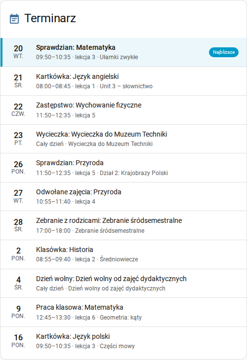
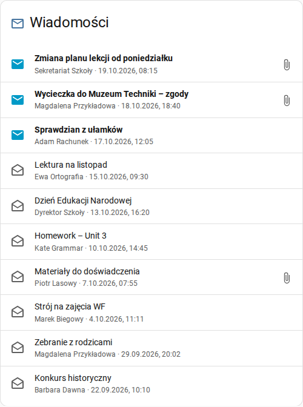
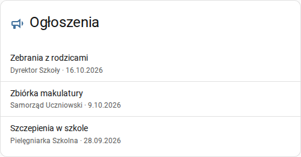
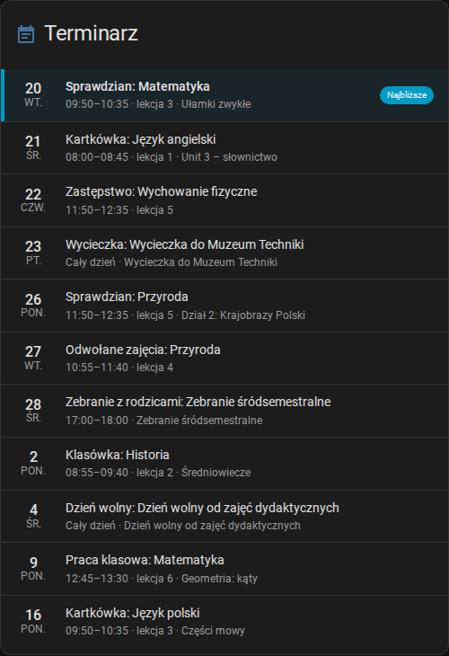
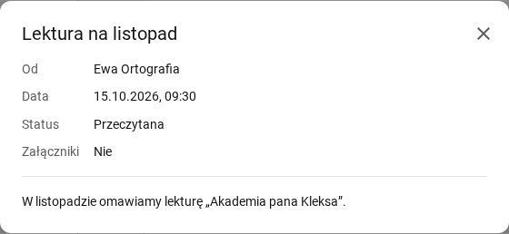

# `librus-apix-homeassistant-ui` - Karty HA dla  `librus-apix-homeassistant`

Karty do panelu Home Assistant (HACS, kategoria „Dashboard”) dla integracji [librus-apix-homeassistant](https://github.com/Tomasz-Mankowski/librus-apix-homeassistant). Pokazują terminarz, wiadomości i ogłoszenia z Librus Synergia.

> [!IMPORTANT]
> Projekt nieoficjalny. Nie jest powiązany z firmą Librus ani przez nią wspierany.

| Terminarz | Wiadomości | Ogłoszenia |
|---|---|---|
|  |  |  |

> [!NOTE]
> Wersja przedpremierowa 0.1.0, przetestowana z symulatorem Librusa. Błędy zgłaszaj w [Issues](https://github.com/Tomasz-Mankowski/librus-apix-homeassistant-ui/issues).

## Wymagania

- Home Assistant 2026.3 lub nowszy.
- Zainstalowana i skonfigurowana integracja [librus-apix-homeassistant](https://github.com/Tomasz-Mankowski/librus-apix-homeassistant).
- [HACS](https://hacs.xyz/).

## Instalacja

[](https://my.home-assistant.io/redirect/hacs_repository/?owner=Tomasz-Mankowski&repository=librus-apix-homeassistant-ui&category=plugin)

Albo ręcznie:

1. HACS → menu **⋮** → **Własne repozytoria**.
2. Repozytorium: `https://github.com/Tomasz-Mankowski/librus-apix-homeassistant-ui`, typ: **Dashboard**.
3. Znajdź **Librus APIX Cards** w HACS i kliknij **Pobierz**. HACS sam dodaje zasób panelu.
4. Odśwież przeglądarkę.

Bez HACS: skopiuj `dist/librus-apix-homeassistant-ui.js` do `config/www/`, a potem **Ustawienia** → **Panele** → **⋮** → **Zasoby** → **Dodaj zasób**: adres `/local/librus-apix-homeassistant-ui.js?v=0.1.0`, typ **Moduł JavaScript**. Po każdej aktualizacji pliku zmień numer po `?v=`.

## Dodanie karty

Edytuj panel → **Dodaj kartę** → wpisz „Librus” → wybierz kartę. Wszystkie opcje ustawisz w edytorze wizualnym. Przykłady YAML są niżej.

Przykłady dotyczą uczennicy „Zofia Testowa” w Home Assistant po polsku. Identyfikatory encji znajdziesz przy integracji Librus APIX.

## Opcje wspólne

| Opcja | Opis | Domyślnie |
|---|---|---|
| `entity` | encja ucznia (wymagana, patrz każda karta) | — |
| `title` | tytuł karty; pusty tekst `""` ukrywa nagłówek | nazwa karty |
| `icon` | ikona w nagłówku, np. `mdi:school` | ikona karty |
| `icon_color` | kolor ikony | kolor ikon motywu |

Kolory (`icon_color`, `unread_color`) wybierasz z palety Home Assistant: `primary`, `accent`, `red`, `pink`, `purple`, `deep-purple`, `indigo`, `blue`, `light-blue`, `cyan`, `teal`, `green`, `light-green`, `lime`, `yellow`, `amber`, `orange`, `deep-orange`, `brown`, `grey`, `blue-grey`, `black`, `white`. Działa też kolor szesnastkowy, np. `"#ff8800"`. Kolory z palety dopasowują się do motywu.

## Terminarz — `custom:librus-schedule-card`

Najbliższe wydarzenia z kalendarza ucznia. Najbliższe jest wyróżnione. Kliknięcie otwiera okno ze wszystkimi szczegółami.

| Opcja | Opis | Domyślnie |
|---|---|---|
| `entity` | kalendarz ucznia, np. `calendar.zofia_testowa_terminarz` | — |
| `days` | ile dni do przodu pokazać (1–200) | `14` |
| `fields` | co pokazać pod tytułem: `date` (data z lewej), `time` (godziny i numer lekcji), `description` (opis), `teacher` (nauczyciel) | `[date, time, description]` |
| `types` | tylko wybrane rodzaje wydarzeń (lista grup i nazw, patrz niżej); puste: wszystkie | wszystkie |
| `highlight_next` | wyróżnienie najbliższego wydarzenia (pasek i tło) | `true` |
| `show_next_label` | etykieta „Najbliższe” przy najbliższym wydarzeniu | `true` |

Grupy rodzajów dla `types`:

| Grupa | Rodzaje |
|---|---|
| `group:tests` | Sprawdzian, Kartkówka, Klasówka, Praca klasowa, Test |
| `group:trips` | Wycieczka, Wyjście |
| `group:meetings` | Zebranie z rodzicami, Wywiadówka, Konsultacje |
| `group:days_off` | Dzień wolny |
| `group:contests` | Konkurs, Olimpiada |
| `group:changes` | Zastępstwo, Odwołane zajęcia |

Każda szkoła może mieć własne rodzaje. Edytor pokazuje grupy i rodzaje znalezione w terminarzu ucznia; inny rodzaj możesz wpisać ręcznie.

```yaml
type: custom:librus-schedule-card
entity: calendar.zofia_testowa_terminarz
title: Sprawdziany
icon: mdi:file-document-edit-outline
icon_color: deep-orange
days: 30
types:
  - group:tests
```

Karta w ciemnym motywie:



## Wiadomości — `custom:librus-messages-card`

Ostatnie wiadomości. Nieprzeczytane mają kolorową, zamkniętą kopertę i pogrubiony tytuł; spinacz oznacza załącznik. Kliknięcie otwiera okno ze szczegółami. Przycisk **Wczytaj treść** czyta treść z Librusa — Librus oznacza wtedy wiadomość jako przeczytaną. Treść przeczytana wcześniej otwiera się od razu.



| Opcja | Opis | Domyślnie |
|---|---|---|
| `entity` | czujnik wiadomości ucznia, np. `sensor.zofia_testowa_wiadomosci` | — |
| `count` | ile ostatnich wiadomości pokazać (1–100) | `5` |
| `fields` | co pokazać: `author` (autor), `date` (data), `attachment` (ikona załącznika), `status` (ikona przeczytania) | wszystkie |
| `unread_color` | kolor oznaczenia nieprzeczytanych | `primary` |
| `highlight_unread` | wyróżnienie nieprzeczytanych wiadomości (pasek i tło w kolorze `unread_color`) | `false` |

```yaml
type: custom:librus-messages-card
entity: sensor.zofia_testowa_wiadomosci
count: 10
unread_color: red
highlight_unread: true
```

Integracja czyta tyle wiadomości, ile ustawiono w jej opcjach (domyślnie 20). `count` większy niż ta liczba pokaże ich tyle, ile jest.

## Ogłoszenia — `custom:librus-announcements-card`

Ostatnie ogłoszenia. Kliknięcie otwiera okno z pełną treścią.

| Opcja | Opis | Domyślnie |
|---|---|---|
| `entity` | czujnik ogłoszeń ucznia, np. `sensor.zofia_testowa_ogloszenia` | — |
| `count` | ile ostatnich ogłoszeń pokazać (1–100) | `5` |
| `fields` | co pokazać: `author` (autor), `date` (data), `preview` (pierwsza linia treści) | `[author, date]` |

```yaml
type: custom:librus-announcements-card
entity: sensor.zofia_testowa_ogloszenia
count: 3
fields:
  - date
  - preview
```

## Wygląd

- Karty używają kolorów i czcionek motywu Home Assistant, także ciemnego.
- Teksty są po polsku lub angielsku, według języka Home Assistant. Treści z Librusa zostają bez zmian.
- Okno szczegółów zamyka **Esc**, przycisk ✕ lub kliknięcie obok okna. Na telefonie okno zajmuje cały ekran.
- W widoku sekcji karta zajmuje całą szerokość sekcji, a jej wysokość zależy od liczby pozycji.

## Licencja

[MIT](LICENSE).

---

## English

Home Assistant dashboard cards (HACS, "Dashboard" category) for the [librus-apix-homeassistant](https://github.com/Tomasz-Mankowski/librus-apix-homeassistant) integration: schedule, messages and announcements from Librus Synergia.

> [!IMPORTANT]
> Unofficial project, not affiliated with or endorsed by Librus.

- **Status:** pre-release 0.1.0, tested with a Librus simulator.
- **Requires:** Home Assistant 2026.3 or newer and the librus-apix-homeassistant integration.
- **Install:** HACS → **⋮** → **Custom repositories** → `https://github.com/Tomasz-Mankowski/librus-apix-homeassistant-ui`, type **Dashboard** → **Download** (HACS adds the dashboard resource) → refresh the browser. Without HACS: copy `dist/librus-apix-homeassistant-ui.js` to `config/www/` and add the resource `/local/librus-apix-homeassistant-ui.js?v=0.1.0` (JavaScript module).
- **Add a card:** edit a dashboard → **Add card** → search "Librus". Every option is in the visual editor.
- **Common options:** `entity` (required), `title` (`""` hides the header), `icon`, `icon_color` (Home Assistant palette name such as `red` or `amber`, or a hex colour).
- **`custom:librus-schedule-card`:** `entity` = the student's calendar; `days` (14, 1–200); `fields` from `date`, `time`, `description`, `teacher` (default date, time, description); `types` = event-type filter with groups `group:tests`, `group:trips`, `group:meetings`, `group:days_off`, `group:contests`, `group:changes` (substitutions, cancelled lessons) and type names (default: all); `highlight_next` (true); `show_next_label` (true).
- **`custom:librus-messages-card`:** `entity` = the student's messages sensor; `count` (5, 1–100); `fields` from `author`, `date`, `attachment`, `status` (default all); `unread_color` (`primary`); `highlight_unread` (false). **Read content** in the pop-up reads the message from Librus, which marks it read; a content read before opens at once.
- **`custom:librus-announcements-card`:** `entity` = the student's announcements sensor; `count` (5, 1–100); `fields` from `author`, `date`, `preview` (default author, date).
- **Look:** theme colours and fonts (light and dark), English or Polish texts by the Home Assistant language; pop-ups close with Esc, ✕ or a click outside and fill the screen on phones.
- **License:** [MIT](LICENSE).
